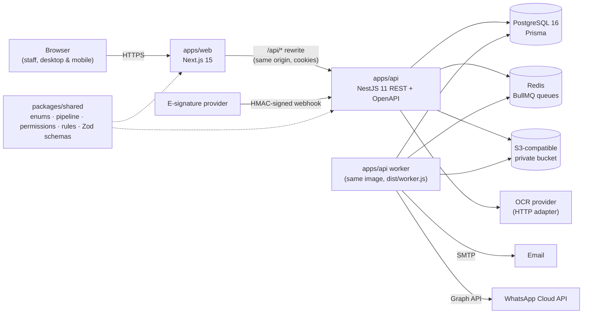
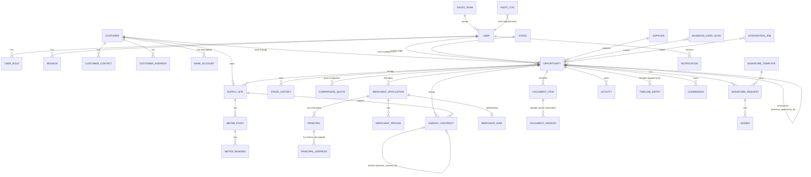

# Architecture

## System overview



| Part | Responsibility |
|---|---|
| `packages/shared` | The domain's single source of truth: enumerations, the 18-stage pipeline, the permission matrix, stage-gate rules, MPRN/GPRN checks and request schemas. Pure TypeScript, no I/O, unit-tested. Both apps import it, so a form and the server validate identically. |
| `apps/api` | NestJS REST API. Owns authentication, authorisation, persistence, encryption, audit, file storage, integrations and background jobs. Every permission is enforced here. |
| `apps/api` worker | Same code and image, started with `node dist/worker.js`: runs BullMQ workers and the cron-style schedules (automations, reminders, virus scans, outbound integrations, retention). |
| `apps/web` | Next.js (App Router) client UI. Talks only to `/api/*`, which Next proxies to the API, so the session cookie stays first-party. TanStack Query for server state, React Hook Form + Zod for forms, Tailwind + Radix primitives for accessible components. |

## Key design decisions

- **Customers and opportunities are separate, permanent records.** Linking or creating a customer changes only `opportunities.customer_id`. A database trigger rejects deleting an opportunity or setting `active = false`, so no code path (or SQL console slip) can hide a deal. "Lost" is an `outcome`, not a stage. Won deals stay in `Live / Won`, keep their salesperson, and can only be reopened by a manager.
- **Stage gates live in one pure function** (`stageGateIssues` in `packages/shared/src/rules.ts`). Gates are cumulative and the first seven stages have none, so leads can be captured with just a name and service. The API loads a `GateFacts` snapshot (restricted values reduced to presence flags) and refuses moves with a list of user-friendly reasons. The UI shows the same list as a checklist.
- **History is never overwritten.** Live and ended contracts and live Worldpay applications are read-only. Renewals create new draft records with `previous_contract_id` / `previous_application_id`. Documents keep every upload as a numbered version.
- **Append-only audit.** `audit_logs` and `timeline_entries` are protected by triggers that block `UPDATE`/`DELETE` (only the retention job may purge old audit rows, via a transaction-local flag). Corrections are new timeline entries pointing at the original.
- **Idempotent automations.** Reminders use an `automation_key` with a partial unique index (one *open* reminder per kind per opportunity). Renewals use a unique `renewal_source_key`. Outbound jobs use a unique `idempotency_key`; inbound webhooks a unique `(provider, event_id)`. Jobs can therefore be retried or run concurrently safely.
- **Adapters for every vendor.** OCR (`OcrProvider`), e-signature (`SignatureProvider`), object storage (`ObjectStorage`), virus scanning (`VirusScanner`), email, WhatsApp and submissions (`SubmissionChannel`) are interfaces with configuration-selected implementations, so no vendor is hard-wired.

## Request lifecycle

1. `ThrottlerGuard`: rate limit per IP.
2. `SessionGuard`: resolves the `uo_session` cookie (SHA-256 lookup) into `req.user`, or 401 unless the route is `@Public()`.
3. `CsrfGuard`: for state-changing methods, checks the Origin header and that `X-CSRF-Token` matches the session's token.
4. `CapabilityGuard`: `@RequireCapability(...)` against the shared matrix.
5. `ZodPipe`: validates the body/query with the shared schema.
6. Service: row-level checks (`OpportunityAccess`), business rules, then a transaction that writes the change plus its audit and timeline entries.
7. `HttpErrorFilter`: one error shape, `{ statusCode, message, issues? }`. 422 = business rule, 400 = invalid input, 403/404/409 as usual; unexpected errors return a reference id and are logged.

## Background jobs

| Queue | Job | Schedule | What it does |
|---|---|---|---|
| automations | `daily` | 07:00 Europe/Dublin | Missing-information and missing-document reminders, signature reminders, supplier/Worldpay follow-ups, activation-due checks, document expiry, renewal creation |
| automations | `leads` | every 15 min, 07:00–20:59 | New-lead assignment (least-loaded salesperson), first-contact and unanswered-message reminders |
| automations | `hourly` | :05 each hour | Activity reminders → notifications; expired session purge |
| automations | `retention` | Sundays 02:30 | Applies the retention policy |
| documents | `scan` | on upload | Virus scan; infected files are deleted and the item reset |
| integrations | `email.send`, `whatsapp.send`, `submission.send` | on demand | Exponential backoff (6 attempts from 30 s). After the last attempt the job is marked `dead` and administrators are notified. |

## Data model



Full column definitions: [field-dictionary.md](field-dictionary.md). Schema: `apps/api/prisma/schema.prisma`. Constraints Prisma can't express (append-only triggers, the opportunity-permanence trigger, the partial unique index and percentage checks) are in `apps/api/prisma/migrations/20261014000100_integrity/migration.sql`.

## Code map

```
packages/shared/src/      enums.ts · stages.ts · permissions.ts · rules.ts · identifiers.ts · dates.ts · schemas.ts
apps/api/src/
  auth/                   sessions, CSRF/session/capability guards, TOTP, scrypt
  common/                 Prisma, field encryption, errors + filter, redaction, value helpers
  config/                 Zod-validated environment
  opportunities/          access (row-level), stages (idempotent sync), gate facts, service + controller
  customers/ energy/ merchant/ documents/ signatures/ activities/ ocr/ integrations/ reports/ admin/
  automations/            renewals + scheduled automations
  jobs/                   queue abstraction, BullMQ workers and schedules
  storage/                S3 / local storage, signed links, virus scanning
apps/web/src/
  app/(app)/              authenticated pages (dashboard, pipeline, opportunities, customers, tasks, scan, admin, account)
  components/             shell, UI primitives, opportunity workspace tabs
  lib/                    API client (CSRF), session, formatting
```
